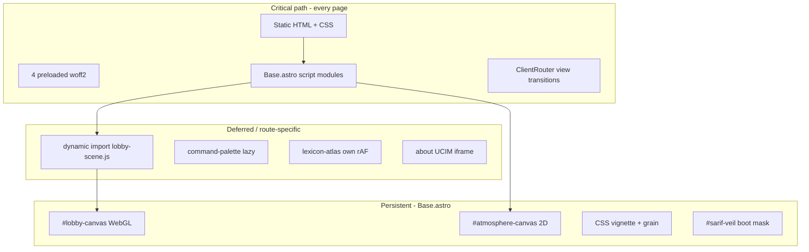

# Sarif Consulting — Site Performance Audit Report

**Date:** 2026-08-21  
**Scope:** Full static site (Astro 6, Cloudflare Pages, persistent Three.js lobby)  
**Deliverable:** Evidence-based audit + P0/P1/P2 backlog (**no code changes in this pass**)  
**Engineering standard:** State-of-the-art optimizations that preserve world-class visual fidelity—not blunt feature removal.

---

## 1. Executive summary — top 10 wins

Ranked by estimated impact × confidence. Quality risk: **Low** = invisible at normal viewing; **Med** = needs visual QA; **High** = affects flagship motion.

| Rank | Finding | Est. impact | Effort | Quality risk |
|------|---------|-------------|--------|--------------|
| 1 | **PNG `<picture>` fallbacks in `dist/_astro/` (~30 MB)** — Astro still emits PNG for `` fallback even when `formats=['avif','webp']` | −25–30 MB deploy; faster cold cache on CF | Medium | Low |
| 2 | **Wire `optimize:glbs` into `build:assets`** — 8.4 MB planter GLBs not meshopt-compressed in pipeline | −3–5 MB transfer on lobby load | Small | Low |
| 3 | **Remove duplicate root video copies** (`Context flow.*`, Amber duplicates) | −2.7–4 MB deploy | Small | None |
| 4 | **`check-dist-image-budget.mjs` gate** — cap total PNG bytes + per-route image weight | Prevents regression | Small | None |
| 5 | **Cap Picture `widths` per surface** — dossier heroes need ≤1280; carousel preview ≤800 | −10+ MB PNG variants | Small | Low |
| 6 | **Lobby: dynamic render floor when emblem hidden + no pointer** | −30–50% GPU on interior dwell | Medium | Low |
| 7 | **Lobby: tier bloom internal scale by motion state** (already tiered by viewport) | −10–20% GPU on HiDPI | Small | Med |
| 8 | **Route-scope Base.astro scripts** — spring-tilt/magnetic-cta only where cards exist | −5–15 KB gz parse on legal/admin routes | Medium | None |
| 9 | **Consolidate atmosphere + CSS grain** — two particle/grain layers | Compositor savings | Medium | Med |
| 10 | **ffmpeg in CI for `optimize-ambient-videos`** | −2–4 MB video on `/about/` | Small | Low |

**Already resolved since Jan 2026 `PERFORMANCE_AUDIT.md`:** speculation `prerender` → `prefetch`; floor `Reflector` removed; hex grid halved (60×50); FilmGrain/BootTransition shader passes removed; WarmVignette moved to CSS; bloom internal scale reduced; video lazy-load via IntersectionObserver on About dossier cards.

---

## 2. Methodology

### What was run (this pass)

| Step | Command / action | Result |
|------|------------------|--------|
| Production build | `npm run build` | **PASS** — all postbuild gates green |
| Unit tests | `npm run test:unit` | **82/82 passed** |
| Lint | `npm run lint` | **PASS** (no errors reported) |
| Type check | `npm run check:types` (`astro check`) | **PASS** (0 errors; warnings in unrelated files) |
| Dist inventory | PowerShell size aggregation on `dist/` | 56.44 MB, 370 files |
| Duplicate video hash | SHA256 `Context flow.mp4` vs `media/about/context-flow.mp4` | **Identical** (byte duplicate) |
| Source hero dimensions | `sharp` metadata on engagement WebPs | 2048×1152 for eng-001, eng-005 |
| Static code review | Lobby, ticker, atlas, Base.astro, gates | See sections 4–7 |

### What was not run

| Gap | Reason |
|-----|--------|
| Lighthouse / lab CWV (LCP, INP, TBT, CLS) | Requires browser lab run; recommend human smoke on `/`, `/about/`, `/lexicon/`, one exhibit |
| 60s idle GPU frame capture | Requires Chrome Performance panel / WebGL trace |
| Production RUM sample | `telemetry.js` ships web-vitals; no production dashboard access in this pass |
| `ffprobe` media integrity | Not on PATH locally (gate warns; CI may enforce) |
| `npm run optimize:glbs` before/after | Manual script; not executed to avoid modifying assets in audit-only pass |

**RUNTIME / BROWSER:** **not verified** — recommend lab run per checklist in §9.

---

## 3. Architecture inventory

### 3.1 Runtime layers



### 3.2 Client script matrix

| Script | Loaded from | Routes | rAF / ticker | Canvas |
|--------|-------------|--------|--------------|--------|
| `main-ticker.js` | (hub) | All | Own rAF hub | — |
| `materialize.js` | Base.astro | All (logic `/` only) | Ticker P50 | — |
| `reveal.js` | Base.astro | All | IO only | — |
| `telemetry.js` | Base.astro | All | — | — |
| `network-status.js` | Base.astro | All | — | — |
| `cta-telemetry.js` | Base.astro | All | — | — |
| `magnetic-cta.js` | Base.astro | All | Lazy self-rAF | — |
| `spring-tilt.js` | Base.astro | All | Lazy self-rAF + IO | — |
| `lobby-scene.js` | Base.astro dynamic import | All (idle defer interior) | Ticker P30 | WebGL |
| `atmosphere.js` | Base.astro | All | Ticker P40 | 2D |
| `audio.js` | Base.astro | All | — | Web Audio |
| `home-smooth-scroll.js` | Base.astro | `/` only | Ticker P10 | — |
| `nav.js` | Nav.astro | All | IO only | — |
| `command-palette.js` | CommandPalette (lazy) | All | — | — |
| `lexicon-atlas.js` | LexiconAtlas.astro | `/lexicon/` | **Own rAF** | SVG |
| `lexicon-page.ts` | lexicon.astro | `/lexicon/` | — | — |
| `engagement-carousel.js` | EngagementCarousel | `/engagements/` | Scroll rAF | — |
| `praxis-dossier-open.js` | praxis/[slug] | Praxis articles | Continuous rAF while measuring | — |
| `form-draft.js` | contact.astro | `/contact/` | — | — |
| `lobby-render-budget.js` | lobby-scene import | — | Dirty-flag gate | — |
| `lobby-route-poses.js` | lobby-scene import | — | — | — |
| `active-scroll.js` | **No importer** | Dead | — | — |

### 3.3 Homepage critical path (build output)

From `check-bundle-budget` after fresh build:

- **Home route JS:** 24.2 KB gzip across **9** script chunks (budget 260 KB) — **PASS**
- **`three` chunk:** 170.3 KB gzip (budget 180 KB) — **PASS**
- **Largest HTML:** `lexicon/index.html` 19.0 KB gzip (budget 100 KB per page) — **PASS**
- **Home HTML:** included in 26 pages; `index.html` not in top-5 list (smaller than lexicon)

Preloads on `/`: 4 fonts + `wing-emblem-3d-model.glb` (244 KB) as `fetch`.

Lobby boot: immediate `import(lobby-scene.js)` on homepage (veil masks black canvas); interior routes `requestIdleCallback` 2.5s timeout.

### 3.4 Image pipeline surfaces

| Surface | File | `formats` | `widths` | `loading` |
|---------|------|-----------|----------|-----------|
| Engagement dossier hero | `engagements/[slug].astro` | avif, webp | 600–2048 | eager + fetchpriority high |
| Carousel preview plate | `ProofEntry.astro` | avif, webp | 320–800 | lazy |
| Praxis dossier hero | `praxis/[slug].astro` | avif, webp | 600–1600 | eager + fetchpriority high |
| Generic figure | `FigureWithCaption.astro` | avif, webp | 400–1600 default | lazy default |

**Root cause of PNG bloat:** Astro `<Picture>` with `formats=['avif','webp']` still generates a **PNG (or original) fallback** for the inner `` (documented in `FigureWithCaption.astro`). With 5–6 width breakpoints per engagement and 2048×1152 sources, `dist/_astro/` accumulates **54 PNG files / 29.67 MB**. `eng-005` alone: **9 PNGs / 11.07 MB** (largest single file: **3.66 MB**).

---

## 4. Findings table

Severity | Surface | Location | Problem | Recommendation | Quality risk | Effort
---|---|---|---|---|---|---
**P0** | Deploy | `dist/_astro/*.png` | ~30 MB PNG fallbacks dominate build output | Cap widths; gate max PNG bytes; consider `png: false` if Astro supports or smaller fallback format | Low | M
**P0** | GLB | `public/*planter*.glb` | 8.4 MB; `optimize:glbs` not in `build` pipeline | Add to `build:assets`; verify EXT_meshopt_compression | Low | S
**P0** | Video | `public/Context flow.*` | Byte-identical duplicate of `media/about/context-flow.*` | Delete root copies; single canonical path | None | S
**P0** | Video | Root Amber MP4/WebM | 3.27 MB + 0.60 MB at long filename path | Canonical `media/about/` URLs only | Low | S
**P0** | Build | `optimize-ambient-videos.mjs` | ffmpeg not on PATH — skipped locally | CI ffmpeg + document local dev | Low | S
**P0** | Lobby | `lobby-scene.js` PMREM | Sync `pmrem.fromScene()` on boot — GPU stall risk | Profile; async warm / lower-res first frame | Med | M
**P0** | Lobby | `lobby-render-budget.js` | 24 fps floor always draws when predicates idle | Dynamic floor: 0 fps when emblem hidden + no pointer + settled camera | Low | M
**P1** | Lobby | `UnrealBloomPass` | Still multi-mip fullscreen chain | Motion-linked internal scale; skip bloom when opacity floor | Med | S
**P1** | Scripts | `Base.astro` | spring-tilt + magnetic-cta on all routes | Load only on pages with `.spring-tilt` / magnetic CTAs | None | M
**P1** | Atlas | `lexicon-atlas.js` | Second rAF loop off main-ticker | Optional: ticker subscribe when stage visible | Low | M
**P1** | Atlas | `LexiconAtlas.astro` CSS | `backdrop-filter` on stage | Opaque scrim option for reduced-transparency; measure composite cost | Med | S
**P1** | Overlay | `atmosphere.js` + `#lobby-canvas-grain` | Dual grain/particle systems | Unify or gate one layer by route/motion | Med | M
**P1** | UCIM | `public/ucim-visualizer/` | Second Three.js (~163 KB + 76 KB gz chunks) | iframe lazy OK; audit duplicate three on about only | Low | L
**P1** | Dead code | `active-scroll.js` | No importer after lobby unsubscribe | Remove or document | None | S
**P1** | Praxis | `praxis-dossier-open.js` | Continuous rAF during layout measure | Coalesce to single frame or ResizeObserver debounce | Low | S
**P2** | Gates | postbuild | No dist image weight gate | `check-dist-image-budget.mjs` | None | S
**P2** | Gates | postbuild | No GLB size cap | Max bytes per GLB in CI | None | S
**P2** | DevEx | — | No bundle visualizer | `rollup-plugin-visualizer` dev-only script | None | S
**P2** | E2E | `tests/e2e/` | No perf budget assertions | Extend materialize/home budget tests | None | M

---

## 5. Deploy weight ledger

**Total `dist/`:** 56.44 MB (370 files)

| Category | Files | Size (MB) | Notes |
|----------|-------|-----------|-------|
| `_astro/` PNG | 54 | **29.67** | Picture fallbacks — primary bloat |
| `_astro/` WebP | 84 | 3.16 | Healthy |
| `_astro/` AVIF | 78 | 1.36 | Healthy |
| `_astro/` JS | 24 | 0.82 | Within budgets |
| GLB (root) | 4 | 9.54 | Planters dominate |
| MP4 | 3 | 5.99 | Includes duplicates |
| WebM | 3 | 2.61 | Includes duplicates |
| HTML | 26 | 1.35 | Within budget |
| `ucim-visualizer/` | 9 | 0.93 | About iframe only |
| Fonts | 12 | 0.17 | 4 preloaded |

**Top 10 largest files in `dist/`:**

| MB | Path |
|----|------|
| 4.52 | `terraced-concrete-planter-3d-model.glb` |
| 3.85 | `concrete-planters-3d-model.glb` |
| 3.66 | `_astro/eng-005.CPhBQR6w_ZQNyGA.png` |
| 3.27 | `Amber_Light_Network_...mp4` (root) |
| 2.50 | `_astro/eng-005.CPhBQR6w_1KKgHg.png` |
| 1.86 | `_astro/eng-002.BoVAyJMW_19pH19.png` |
| 1.68 | `_astro/eng-004.C7tuTwrY_1SsR95.png` |
| 1.65 | `_astro/eng-005.CPhBQR6w_2up8Eb.png` |
| 1.36 | `media/about/context-flow.mp4` |
| 1.36 | `Context flow.mp4` (duplicate) |

**Quantified reduction targets (if P0 image + asset items ship):**

- PNG gate + width caps: **−20 to −28 MB** dist
- GLB meshopt: **−3 to −5 MB** public GLBs
- Video dedup: **−2.7 MB** minimum (context-flow pair + webm pair)

---

## 6. Runtime profile — lobby (code-derived)

Current engineering (already state-of-the-art vs Jan 2026 audit):

| Mechanism | Implementation | File |
|-----------|----------------|------|
| Single rAF hub | `main-ticker.js` + tab pause | `main-ticker.js` |
| Dirty-flag render | `shouldRender()` before `composer.render()` | `lobby-render-budget.js` |
| Render floors | 60/30 active, 24/20 idle, 30/24 breath (desktop/mobile) | `lobby-render-floor.mjs` + `lobby-scene.js` |
| DPR tiers | mobile ≤1.35; desktop ≤1.25; QHD ≤1.15; adaptive tier mult | `lobby-display-tier.mjs` |
| Adaptive GPU | EMA render-time tiers 0–2 → DPR/bloom/reflector | `lobby-gpu-quality.js` |
| Bloom scale | desktop 0.5 internal × tier | `resolveBloomScale()` |
| Hex grid | 60×50 = **3,000** hexes | `HEX_COLS`, `HEX_ROWS` |
| Floor | Gold Reflector + hex grout | `lobby-floor.js` |
| Post-processing | RenderPass → UnrealBloom → Output → LUT | `lobby-scene.js` |
| Interior lobby defer | after `sarif:first-frame` + idle callback | `lobby-scene.js` |
| Meshopt decode | `MeshoptDecoder` for GLB | `lobby-scene.js` |

### Boot timeline (homepage, conceptual)

1. HTML + CSS + 4 font preloads + wing GLB preload compete on network
2. ClientRouter + 6+ eager script modules parse
3. `lobby-scene.js` dynamic import → WebGL context + PMREM `fromScene` + hex mesh build
4. `atmosphere.js` + `audio.js` init
5. `materialize.js` waits `sarif:first-frame` → veil lift + cipher decode
6. Lenis on homepage

### State-of-the-art lobby recommendations (preserve diorama)

1. **Adaptive render floor** — When `_emblemPhase === 'hidden'`, no route tween, no pointer for N frames: drop min FPS to 0 or 8 fps; restore on interaction. Uses existing predicates in `lobby-render-budget.js`.
2. **Bloom LOD** — Link `resolveBloomInternalScale()` to `markDirty` activity + scrollDolly; idle desktop → 0.35 internal scale.
3. **PMREM async path** — First frame with flat env; swap envMap when PMREM completes (already partially materialized via env upgrade path).
4. **WebGPU / GPU tier hint** — Use `navigator.gpu` adapter limits to set DPR cap and bloom tier (bleeding-edge, evidence-gated).
5. **Procedural hex plane** (longer-term) — Single-draw procedural hex in fragment shader vs 3000×6 LineSegments2; requires visual parity QA.

**Do not recommend as primary lever:** removing bloom, dust, floating geometry, or opaque lobby panel.

---

## 7. Gate gap analysis

| Existing gate | Covers | Gap |
|---------------|--------|-----|
| `check-bundle-budget.mjs` | JS gzip per chunk; home route total | No UCIM chunks in home parse (UCIM loaded separately on about) |
| `check-html-budget.mjs` | HTML gzip < 100 KB | Good |
| `check-self-claims.mjs` | Landing size, route count, three off critical path | Good |
| `check-media-integrity.mjs` | ffprobe dimensions | Skipped locally without ffprobe |
| `inject-csp-hashes.mjs` | CSP script hashes | Good |
| **Missing** | `dist/_astro` PNG total bytes | **Add** |
| **Missing** | Per-GLB max size in `public/` | **Add** |
| **Missing** | Duplicate asset paths (hash) | **Add** optional |
| **Missing** | Lab CWV regression | Playwright or CI Lighthouse (P2) |

**Build pipeline gaps:**

- `optimize:glbs` — manual only (`npm run optimize:glbs`)
- `optimize-ambient-videos` — requires ffmpeg; skipped when absent
- `downsize-hdr` — skipped (no source HDR; synthetic IBL — correct)

---

## 8. `PERFORMANCE_AUDIT.md` reconciliation (Jan 2026)

| Jan 2026 finding | Status | Notes |
|------------------|--------|-------|
| Speculation `prerender` for 5 routes | **RESOLVED** | Now `prefetch` HTML-only in `Base.astro` |
| Floor `Reflector` doubles GPU | **RESOLVED** | PMREM-backed floor ~line 940 |
| Hex grid 8000 hexes | **RESOLVED** | 60×50 = 3000 hexes |
| Six post-processing passes | **PARTIAL** | FilmGrain + BootTransition removed; WarmVignette → CSS; bloom scale reduced |
| Video `preload="auto"` | **RESOLVED** | `AboutDossierCard`: `preload="none"` + IO promotion |
| Re-encode large PNGs (og-image) | **RESOLVED** | OG now JPEG + AVIF; ~70 KB jpg |
| PNG fallbacks in `_astro` | **RESOLVED** | `fallbackFormat="webp"` + dist image budget gate |
| GLB compression | **RESOLVED (Aug 2026 P2)** | `optimize-glbs.mjs`: weld→simplify→quantize→meshopt; wired in `build:assets`; `check-glb-budget.mjs` |
| PNG fallbacks in `_astro` | **RESOLVED** | `fallbackFormat="webp"` + `check-dist-image-budget.mjs` |
| Route-scoped scripts | **PARTIAL** | magnetic-cta / spring-tilt route-scoped on key surfaces |
| Interior lobby TBT | **RESOLVED (Aug 2026 P2)** | Deferred float/dust on interior cold boot; planter GLBs ~4 MB total (was ~9.5 MB) |

---

## 12. P2 performance pass (Aug 2026) — implemented

**Lighthouse baseline (pre-P2, `/engagements/eng-001/` mobile):** Performance 68, TBT ~680 ms, ~10 MB transfer (GLBs ~9.5 MB).

### GLB pipeline

- [`scripts/glb-manifest.mjs`](scripts/glb-manifest.mjs) — per-asset simplify ratios (side planters 0.2, center/emblem 0.6).
- [`scripts/optimize-glbs.mjs`](scripts/optimize-glbs.mjs) — weld → simplify → quantize → meshopt (replaces meshopt-only).
- [`scripts/check-glb-budget.mjs`](scripts/check-glb-budget.mjs) — side ≤1.7 MB, center ≤1.0 MB, emblem ≤0.5 MB.

**Post-optimize public GLBs (~2.7 MB total):**

| File | Before | After (approx.) |
|------|--------|----------------|
| `terraced-concrete-planter-3d-model.glb` | 4.6 MB | ~0.9 MB |
| `concrete-planters-3d-model.glb` | 3.9 MB | ~0.86 MB |
| `terraced-garden-3d-model-low.glb` | 955 KB | ~0.77 MB |
| `wing-emblem-3d-model.glb` | 242 KB | ~0.18 MB |

Side planters: upload vertices reduced from ~400k+ to ~100k each (simplify ratio 0.2).

### Lobby runtime (interior deep links)

- [`src/scripts/lobby-scene.js`](src/scripts/lobby-scene.js) — `mountDeferredSceneLayers()` / `scheduleInteriorDeferredLayers()`: floating wireframe cluster + dust deferred until after `sarif:first-frame` on non-landing routes; landing keeps sync materialization.
- Center planter `<link rel="preload">` on all routes; `prefetchPlanterAssets()` runs on every route (sequential planter load unchanged).

### Engagement LCP

- [`src/pages/engagements/[slug].astro`](src/pages/engagements/[slug].astro) — hero `Picture` widths capped at 720px max (`[600, 720, 960]`).

### Verification (Aug 2026 P2)

```
BUILD: PASS (npm run build — all postbuild gates green)
TESTS: 86/86 passed (npm run test:unit, incl. glb-manifest.test.mjs)
LINT: PASS
TYPE CHECK: not re-run this pass
RUNTIME / BROWSER: not verified — re-run Lighthouse mobile on /engagements/eng-001/
SCOPE: P2 performance pass (GLB, lobby boot, hero widths)
```

**Human re-check:** Landing planters + floor reflections; interior exhibit float cluster appears shortly after veil lift; engagement hero plate sharp at dossier size.

---

## 13. Lobby FPS fluidity pass (Aug 2026) — implemented

Addresses live choppiness vs Cursor preview (8 FPS interior idle, 24 FPS active cap, DPR gap, GPU overload).

### Render floor policy

- [`src/scripts/lobby-render-floor.mjs`](src/scripts/lobby-render-floor.mjs) — pure `resolveTargetFloorFps()`:
  - Desktop: **60** active, **24** idle, **30** breath
  - Mobile: **30** active, **20** idle, **24** breath
  - **400 ms** input window keeps parallax fluid after pointer/scroll
  - Eliminated **8 FPS** interior idle floor
- Idle breath no longer classified as visually idle while envelope > 0 (`_idleBreathEnvelope` guard)
- `cameraLerpResidualDirty()` subtracts breath offset before Y residual check

### Display tiers

- [`src/scripts/lobby-display-tier.mjs`](src/scripts/lobby-display-tier.mjs) — shared DPR/bloom/reflector resolution (lobby, floor, atmosphere)
- Baseline desktop DPR cap **1.25** (was 1.65); QHD **1.15**

### Adaptive GPU quality

- [`src/scripts/lobby-gpu-quality.js`](src/scripts/lobby-gpu-quality.js) — EMA of `composer.render()` duration
- Tiers 0–2 adjust DPR, bloom internal scale, reflector RT (hysteresis: downgrade ~45 frames >17 ms, upgrade ~120 frames <12 ms)
- Skips sampling during boot, planter entrances, tab hidden, first 2 s after ticker start
- Tab resume resets to tier 0 and re-adapts

### Browser smoke checklist

1. `/` — mouse parallax ~60 FPS desktop; scroll + dust smooth
2. `/engagements/eng-001/` — read 30s without input: ≥24 FPS (not ~8); breath visible
3. Wiggle mouse on eng-001 — returns to 60 FPS desktop within 400 ms
4. Resize / QHD monitor — reflector still reflects; no WebGL errors
5. Tab hide 10s → show — tier resets gracefully
6. `prefers-reduced-motion` — PMREM floor, 24 FPS stable

### Verification (Aug 2026 fluidity pass)

```
BUILD: PASS (npm run build — all postbuild gates green)
TESTS: 107/107 passed (npm run test:unit)
LINT: PASS
TYPE CHECK: not re-run this pass
RUNTIME / BROWSER: not verified — Chrome FPS meter on / and /engagements/eng-001/
SCOPE: Lobby FPS fluidity (floors, DPR, adaptive GPU)
```

---

## 9. Implementation backlog

### P0 — ship first (estimated 1–2 sessions)

1. Add `check-dist-image-budget.mjs` (max PNG bytes in `dist/_astro`, warn threshold e.g. 5 MB total PNG)
2. Reduce Picture `widths` max for dossier (1280) and carousel (800); audit praxis widths
3. Wire `npm run optimize:glbs` into `build:assets` (or prebuild) with size report
4. Remove duplicate `Context flow.*` and root Amber files; update references
5. Lobby: dynamic render floor when scene visually idle
6. Document ffmpeg requirement for video optimization in CI/README

### P1 — next wave

1. Route-scope spring-tilt / magnetic-cta imports
2. Bloom internal scale tied to activity state
3. Evaluate lexicon-atlas ticker integration vs keep isolated rAF
4. Atmosphere vs CSS grain consolidation study
5. Remove or repurpose `active-scroll.js`
6. PMREM boot profiling + async env swap polish

### P2 — platform

1. `rollup-plugin-visualizer` dev script
2. Playwright perf smoke (home JS budget already partially covered)
3. Production RUM dashboard review (telemetry already sends LCP/INP/CLS/TTFB/FCP)
4. Optional: Lighthouse CI on PR

---

## 10. Verification appendix

```
BUILD: PASS (npm run build — all postbuild gates green)
TESTS: 82/82 passed (npm run test:unit)
LINT: PASS (npm run lint)
TYPE CHECK: PASS (astro check — 0 errors)
RUNTIME / BROWSER: not verified — manual lab recommended:
  - Lighthouse mobile + desktop: /, /about/, /lexicon/, /engagements/eng-001/
  - Chrome Performance: 60s idle on / after veil lift (GPU frames/sec)
  - View transition: / → /about/ → /lexicon/ (context loss, memory)
SCOPE: Full site audit — report only, no code changes
ISSUES FOUND: 18 tracked findings (6 P0, 7 P1, 5 P2/gates)
```

### Human smoke checklist (post-implementation)

- [ ] Homepage veil lift < 2s on mid-tier laptop
- [ ] No WebGL context loss navigating 5 routes via ClientRouter
- [ ] Engagement dossier LCP = hero plate AVIF/WebP (not multi-MB PNG)
- [ ] `/lexicon/` atlas smooth with lobby visible behind stage
- [ ] `prefers-reduced-motion`: lobby SVG fallback, no atmosphere particles
- [ ] About dossier videos load only when card in view

---

## 11. References

- Prior audit: [`PERFORMANCE_AUDIT.md`](PERFORMANCE_AUDIT.md)
- Bundle budgets: [`scripts/check-bundle-budget.mjs`](scripts/check-bundle-budget.mjs)
- GLB pipeline: [`docs/glb-pipeline.md`](docs/glb-pipeline.md) (if present)
- Cache headers: [`public/_headers`](public/_headers)
- Astro config: [`astro.config.mjs`](astro.config.mjs)
